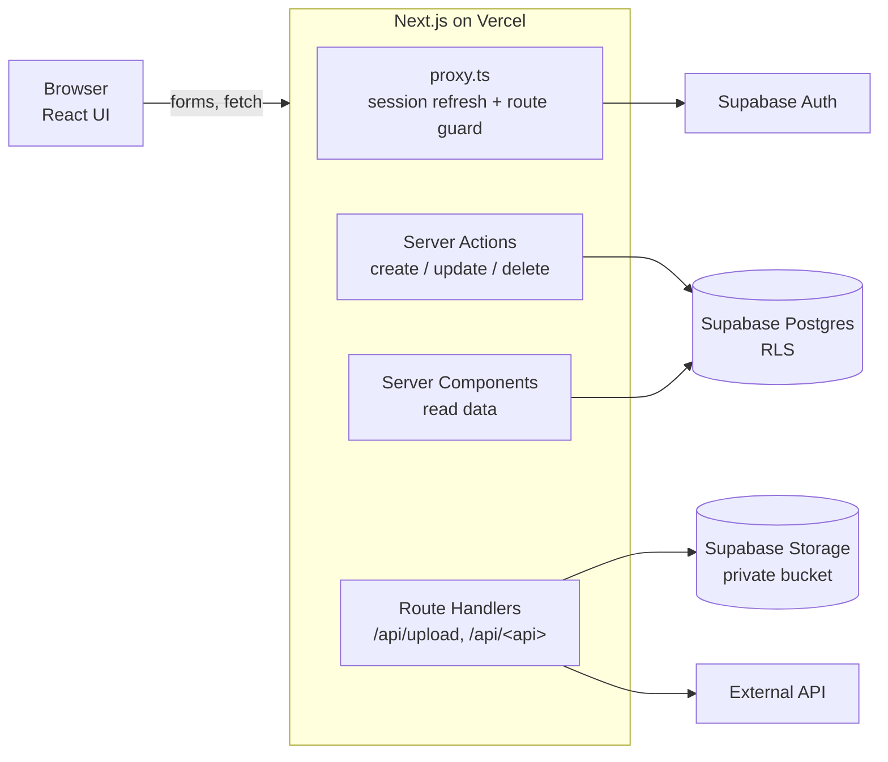

# <App name>

<One sentence: who it's for and what it does.>

**Live app:** https://<project>.vercel.app
**Repository:** https://github.com/<user>/<project>

<!-- [PLACEHOLDER] Edit or remove this line for the event. -->
Built in 120 minutes for VSPARK26 (Web Development track) with Next.js, Supabase and Vercel.

---

## Features

<!-- Keep the rows that are built; delete the rest. -->

| Feature | What the user can do |
|---|---|
| Accounts | Sign up, log in, log out; private pages are protected |
| Dashboard | See a personal dashboard with real counts from the database |
| <Items> | Create, view, search, filter, edit and delete their own <items> |
| Images | Upload a photo for each <item>; stored privately and shown with expiring links |
| <API feature> | See <live weather / map / rates> for each <item>, with clear error messages |
| Responsive | Works on phones, tablets, desktops and wide monitors up to 2400 px |

## Tech stack

| Layer | Technology |
|---|---|
| Framework | Next.js 16 (App Router, Server Actions, Route Handlers), TypeScript |
| UI | Tailwind CSS v4, shadcn/ui (Base UI), Lucide icons, Motion |
| Auth | Supabase Auth with `@supabase/ssr` (cookie sessions) |
| Database | Supabase Postgres with Row Level Security |
| Storage | Supabase Storage (private bucket, signed URLs) |
| External API | <OpenWeatherMap (fallback: Open-Meteo)> via axios |
| Validation | Zod + React Hook Form (same schemas on client and server) |
| Hosting | Vercel (deploys on every push to `main`) |
| Testing | Vitest (unit), Playwright (end-to-end) |

## Architecture



**How a request flows:** the browser sends a form or fetch → `proxy.ts` refreshes the session and
blocks logged-out users → a Server Action or Route Handler checks the user and validates the input
with Zod → Supabase applies Row Level Security, so each user only reaches their own rows and files.

| Concern | Approach |
|---|---|
| Sessions | JWT in HTTP-only cookies via `@supabase/ssr`, refreshed on every request |
| Route protection | 3 layers: `proxy.ts` redirect → `requireUser()` in every private page and action → RLS in Postgres |
| Validation | One Zod schema per form, used in the browser and again on the server; DB `check` constraints match |
| Errors | Typed action results, friendly messages, `error.tsx` / `not-found.tsx`, API errors mapped to status codes |
| Secrets | Server-only keys; only the Supabase URL and anon key are public (safe with RLS) |
| Layout | Public pages: header and footer. Private pages: portal with sidebar and top bar. Login and sign-up: split screen |

### Folder structure
```
src/
├── app/
│   ├── (app)/           # public pages with header and footer
│   ├── (auth)/          # login, sign-up, auth actions, split-screen layout
│   ├── (portal)/        # private pages with sidebar and top bar (dashboard)
│   ├── api/             # route handlers: health, upload
│   └── auth/callback/   # email link code exchange
├── components/
│   ├── brand/           # code-built logo
│   ├── portal/          # sidebar, top bar, hero, stat and list cards
│   └── ui/              # shadcn/ui components
├── config/              # site settings and portal navigation
├── lib/
│   ├── supabase/        # browser + server clients, session proxy
│   ├── validations/     # Zod schemas
│   ├── http.ts          # axios client for external APIs
│   └── storage.ts       # bucket helpers, signed URLs
└── proxy.ts             # session refresh + route protection
supabase/migrations/     # SQL: tables, RLS policies, bucket
e2e/                     # Playwright tests
```

## Data model

| Table | Key fields | Security |
|---|---|---|
| `profiles` | `id` → auth user, `full_name`, `avatar_path` | Owner can read and update; created by a sign-up trigger |
| `<items>` | `id`, `user_id`, `<title>`, `<fields…>`, `image_path`, timestamps | Owner-only select / insert / update / delete |
| Bucket `images` | `{user_id}/{uuid}.webp`, 5 MB, images only | Owner-only folder access |

## Pipelines

| Pipeline | Steps |
|---|---|
| **Authentication** | Sign-up form → Zod → `signUp` action → Supabase Auth → profile trigger → cookie session → dashboard |
| **CRUD** | Form → Zod (browser) → Server Action → `requireUser()` → Zod (server) → Postgres with RLS → `revalidatePath` → list updates |
| **File upload** | Dropzone → type/size check → compress to WebP → `/api/upload` (auth, size, type, file signature) → Storage `{user_id}/…` → path saved on the row |
| **File retrieval** | Server reads rows → batch signed URLs (1 hour) → `next/image` |
| **External API** | Card → `/api/<api>` (auth, Zod) → cached service → <API> with timeout + retry → Zod-validated response → loading / error / data states |

## Environment variables

Copy `.env.example` to `.env.local` and fill in the values.

| Variable | Required | Public | Where to get it |
|---|---|---|---|
| `NEXT_PUBLIC_SUPABASE_URL` | Yes | Yes | Supabase → Project Settings → API → Project URL |
| `NEXT_PUBLIC_SUPABASE_ANON_KEY` | Yes | Yes (protected by RLS) | Supabase → Project Settings → API → anon / publishable key |
| `<API_KEY_NAME>` | <Optional> | **No** | <Where to get it> |

## API keys you need

| Service | Key | Cost | Notes |
|---|---|---|---|
| Supabase | Project URL + anon key | Free plan | Create a project at supabase.com |
| <External API> | <API key> | <Free tier> | <Notes> |

## Run it locally

**Requirements:** Node.js 20 or newer, npm, a Supabase account.

1. **Clone and install**
   ```bash
   git clone https://github.com/<user>/<project>.git
   cd <project>
   npm install
   ```
2. **Create a Supabase project** at supabase.com.
3. **Create the database:** open Supabase → SQL Editor and run each file in `supabase/migrations/` in name order.
   (With the Supabase CLI: `supabase link --project-ref <ref>` then `supabase db push`.)
4. **Auth settings:** Supabase → Authentication → Sign In / Providers → Email → turn **Confirm email** off;
   Authentication → URL Configuration → add `http://localhost:3000/**` to Redirect URLs.
5. **Environment variables**
   ```bash
   cp .env.example .env.local     # Windows PowerShell: Copy-Item .env.example .env.local
   ```
   Fill in the values from the table above.
6. **Start**
   ```bash
   npm run dev
   ```
   Open http://localhost:3000 and create an account.

### Useful commands
| Command | Does |
|---|---|
| `npm run dev` | Development server |
| `npm run build` | Production build |
| `npm run quick` | Type check + lint |
| `npm run check` | Type check + lint + build |
| `npm test` | Unit tests (Vitest) |
| `npm run test:e2e` | End-to-end tests (Playwright) |
| `npm run format` | Format the code (Prettier) |

## Deployment

1. Import the GitHub repo in Vercel (or `vercel link`).
2. Add the variables from the table above in Vercel → Settings → Environment Variables.
3. Deploy; every push to `main` deploys again.
4. In Supabase → Authentication → URL Configuration, set the Site URL to the Vercel URL and add `https://<project>.vercel.app/**` to Redirect URLs.

## Screenshots (optional)

<!-- Optional: add this section at the very end only if you choose to take screenshots.
     Otherwise delete it, so the README has no broken images. -->

| # | Step | Screenshot |
|---|---|---|
| 1 | Landing page |  |
| 2 | Sign-up with validation |  |
| … | … | … |

## Security

- Row Level Security on every table and the storage bucket
- Server-side validation on every write; input validated again by database constraints
- Upload route checks session, size, type and file signature
- API keys are server-only; `.env.local` is git-ignored; the Supabase service role key is not used anywhere

## Testing

| Type | Command | Covers |
|---|---|---|
| Unit | `npm test` | Validation, storage paths and API error mapping |
| End-to-end | `npm run test:e2e` | Health check, home page, protected-route redirect, mobile menu, login layout |

## Team

| Name | Role |
|---|---|
| <Name> | <e.g. Auth, database, deployment> |
| <Name> | <e.g. UI, storage, API> |
