# CaptionFlow

AI social media caption generator and scheduler: describe a post, get 3 captions with hashtags from Google Gemini, pick one, schedule it, get email reminders and keep a backup in Google Drive.

**Live app:** https://vspark-alpha.vercel.app
**Repository:** https://github.com/ahmadweb88/vspark

## Student details

| Item | Details |
|---|---|
| Name | Muhammad Ahmad |
| Registration number | _add your registration number_ |
| GitHub URL | https://github.com/ahmadweb88/vspark |
| Live URL | https://vspark-alpha.vercel.app |
| Drive location | _add the Google Drive folder link_ |

## Features

| Feature | What the user can do |
|---|---|
| Accounts | Sign up, log in, log out (Supabase email auth). Every page except login and sign-up is protected |
| AI captions | Enter a prompt, choose platform (Instagram / X / LinkedIn) and tone → `/api/captions` calls Gemini `gemini-2.5-flash` → exactly 3 captions with hashtags, validated with Zod. Loading skeletons, error message and Retry |
| Save & schedule | Pick a caption, edit it, choose date and time, status and an optional image → saved in Supabase `posts` |
| Feed | All posts, upcoming first, with status badge, text search, edit (text and time) and delete with a confirm dialog |
| Google Drive sync | "Connect Google Drive" (Google Identity Services, `drive.file` scope). Each save or edit creates or updates a JSON file in a "CaptionFlow" Drive folder (multipart upload); deleting a post deletes its file. Badge shows "Synced to Drive" with a link, or "Not synced" |
| Email | Email sent as soon as a post is scheduled (nodemailer + Gmail SMTP). Daily Vercel Cron `/api/cron/notify` (protected by `CRON_SECRET`) emails posts due in the next 24 hours |
| Settings | Notification email, on/off, minutes before, subject and message templates with `{caption}`, `{time}`, `{platform}`. "Send test email" button |
| Images | Optional post image, compressed in the browser, stored in the private Supabase Storage bucket `images`, shown with signed URLs |

## Tech stack

Next.js 16 (App Router, Server Actions, Route Handlers) · TypeScript · Tailwind CSS v4 · shadcn/ui (Base UI) · Supabase (Auth, Postgres with RLS, Storage) · `@google/genai` · nodemailer · Google Drive REST v3 · Zod + React Hook Form · Vercel (hosting and cron).

## Architecture

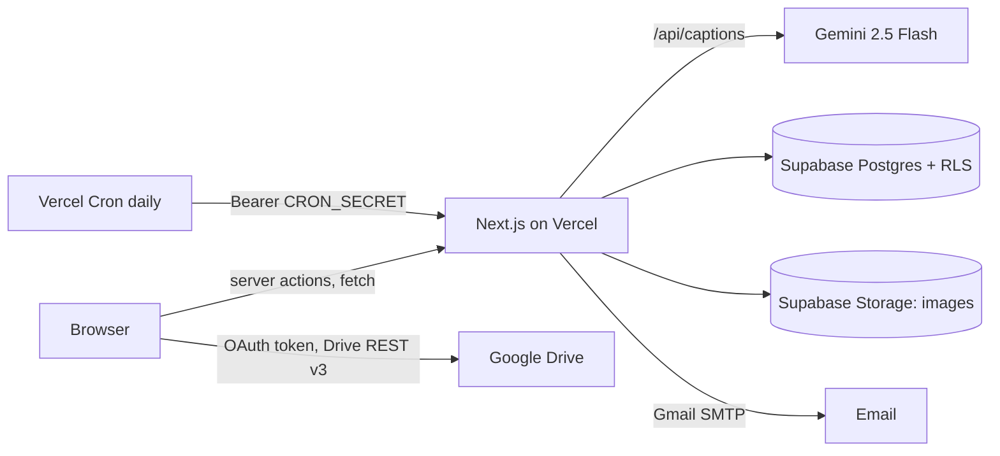

- API keys (`GEMINI_API_KEY`, Gmail) are used only on the server.
- Every table and the bucket use Row Level Security, so each user only reaches their own rows and files.
- The cron route has no user session. It reads due posts through two `security definer` database functions that check the same `CRON_SECRET`, so no `service_role` key is used.
- Drive uses the user's own OAuth token in the browser; only the Drive file id is stored in Supabase.

## Data model

- `posts`: id, user_id, caption, platform, scheduled_at, status (draft / scheduled / sent), image_path, drive_file_id, reminder_sent_at, created_at, updated_at
- `notification_settings`: user_id, email, enabled, remind_minutes_before, subject_template, message_template, updated_at
- Storage bucket `images` (private, 5 MB, JPG / PNG / WebP, files under `{user_id}/`)

Migrations are in `supabase/migrations/`.

## Environment variables

Copy `.env.example` to `.env.local` and fill in:

| Name | Where to get it |
|---|---|
| `NEXT_PUBLIC_SUPABASE_URL`, `NEXT_PUBLIC_SUPABASE_ANON_KEY` | Supabase → Project Settings → API |
| `GEMINI_API_KEY` | Google AI Studio → API keys |
| `NEXT_PUBLIC_GOOGLE_CLIENT_ID` | Google Cloud → APIs & Services → Credentials → OAuth client (Web), with your site in Authorized JavaScript origins; enable the Google Drive API |
| `GMAIL_USER`, `GMAIL_APP_PASSWORD` | Your Gmail address and a Google Account app password (2-Step Verification required) |
| `CRON_SECRET` | Any long random string |

## Setup

```bash
npm install
# apply supabase/migrations/*.sql in the Supabase SQL editor, then store the cron secret:
#   insert into private.app_secrets (name, value) values ('cron_secret', '<CRON_SECRET>');
npm run dev
```

Deploy: push to `main`; Vercel builds automatically and runs the daily cron from `vercel.json`.

## Screenshots

1. **Log in** — email and password login on the split-screen auth page.
   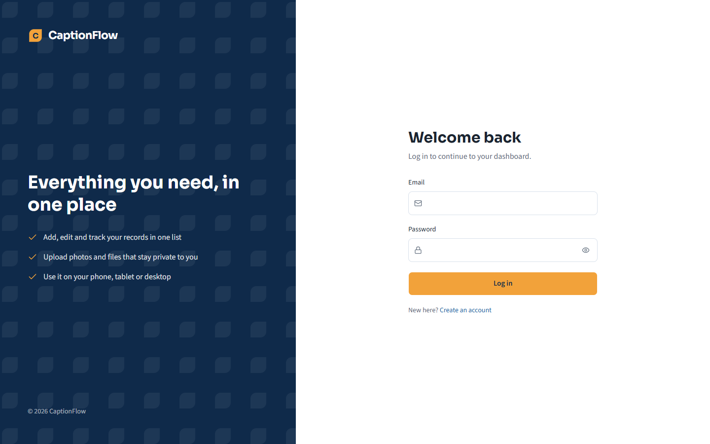
2. **Sign up** — create an account with name, email and password.
   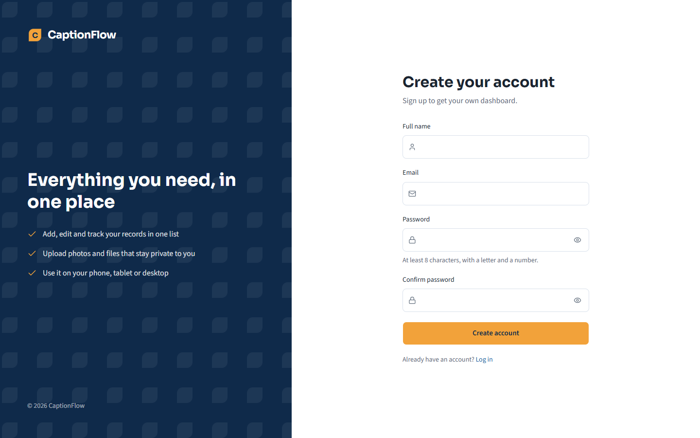
3. **Dashboard** — the caption generator next to your feed of saved posts.
   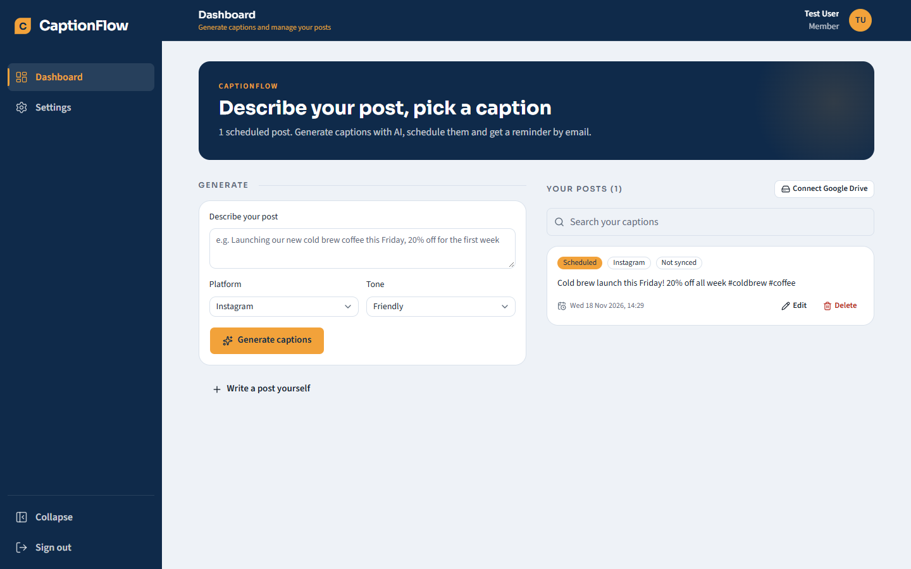
4. **Generate captions** — 3 AI captions with hashtags from Gemini, each with a "Use this caption" button.
   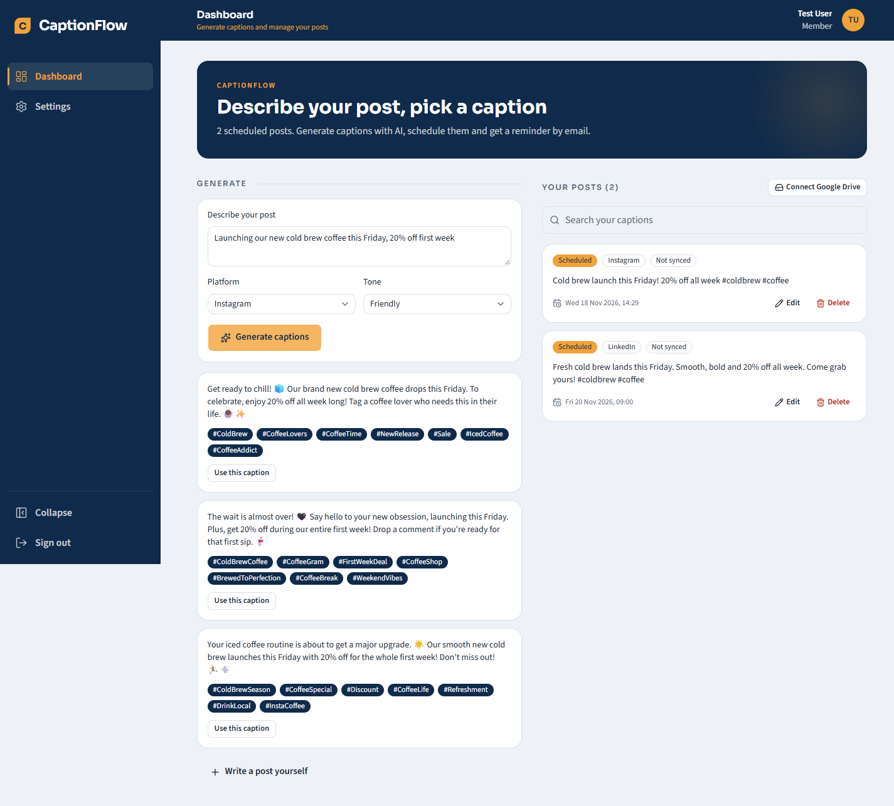
   If the AI service is busy, a clear message with a Retry button is shown instead.
   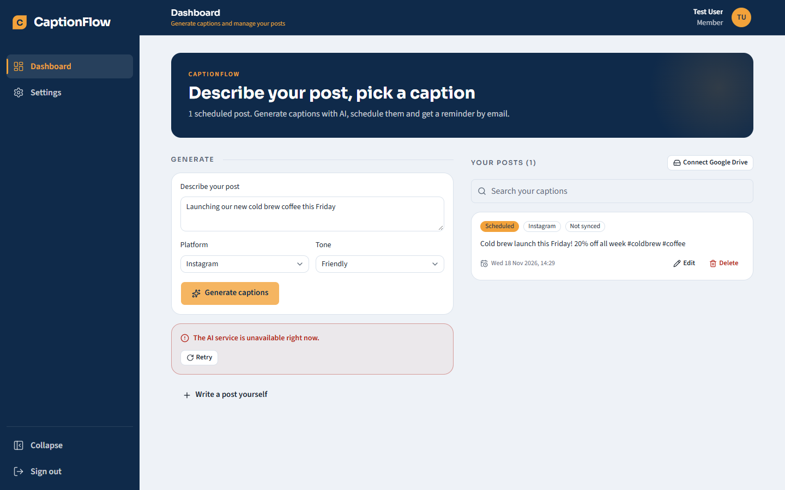
5. **Write a post yourself** — caption, platform, status, date and time in the save dialog.
   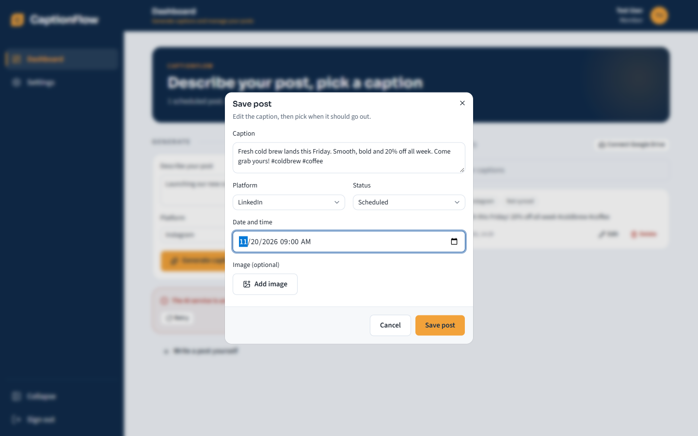
6. **Feed and search** — posts with Scheduled and Not synced badges, filtered by a search term.
   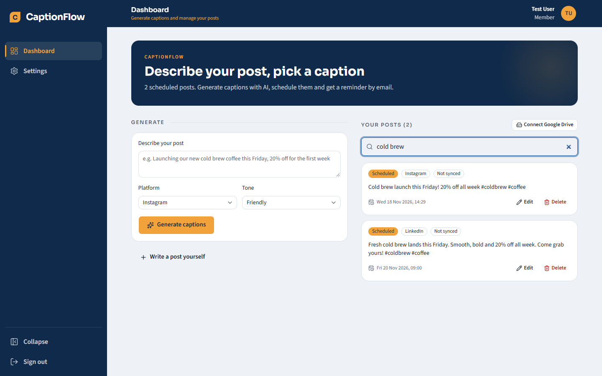
7. **Edit a post** — the edit dialog with the saved values.
   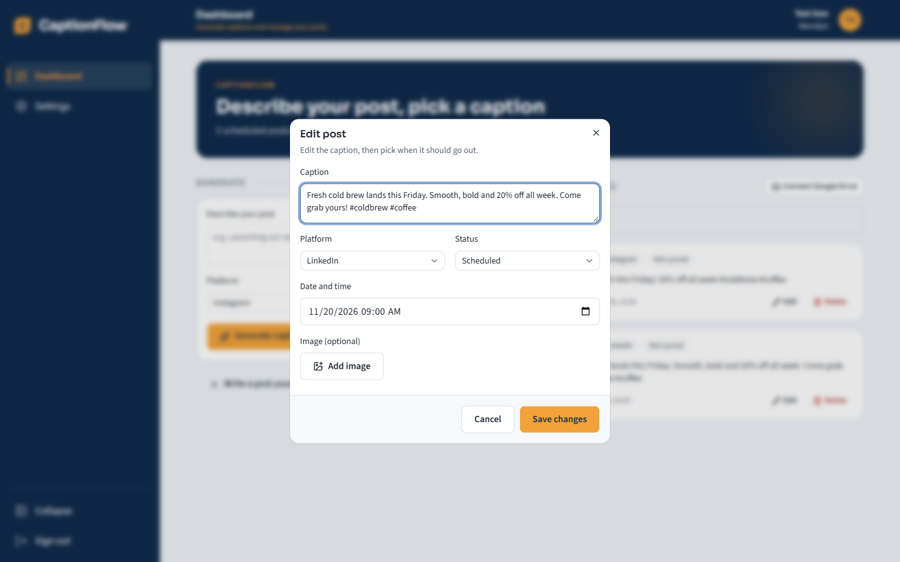
8. **Delete a post** — confirm dialog before anything is removed.
   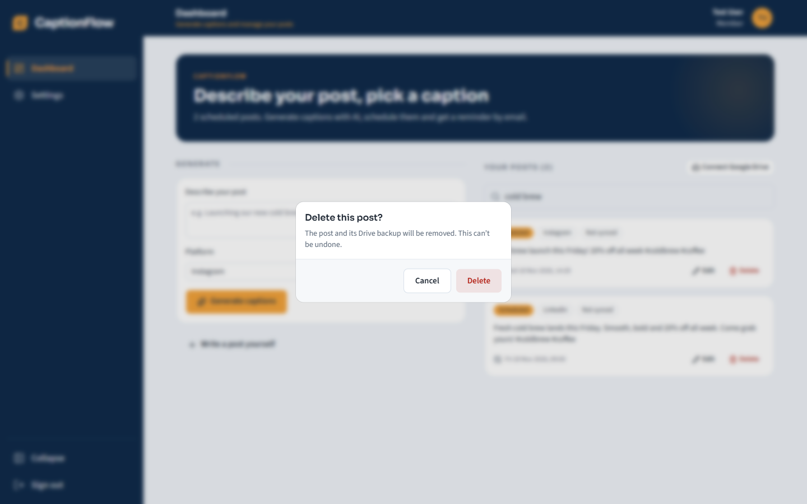
9. **Settings** — notification email, reminder timing and subject/message templates.
   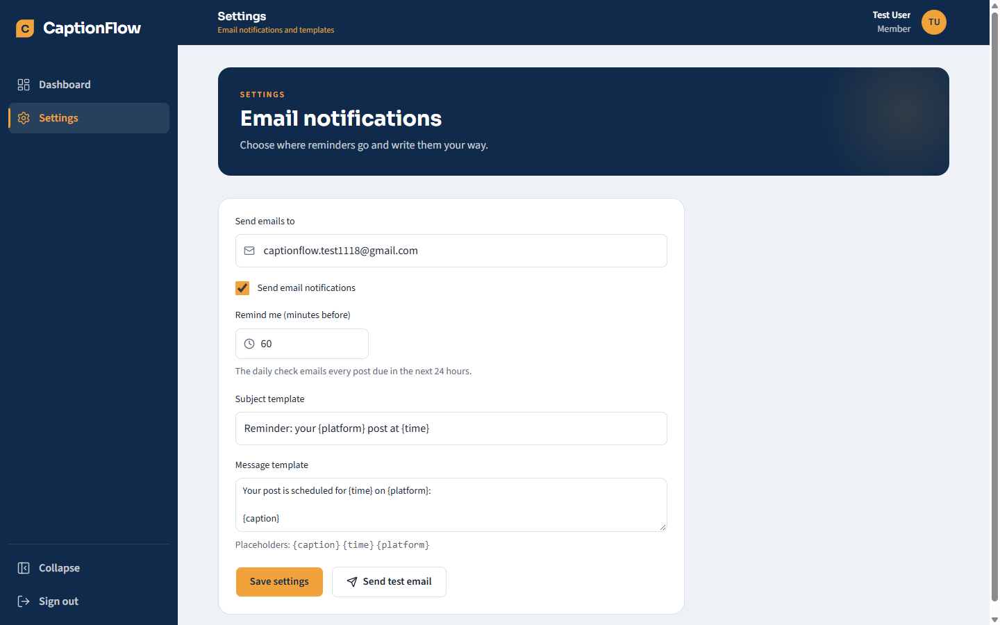
10. **Mobile** — the dashboard at 375px wide.
    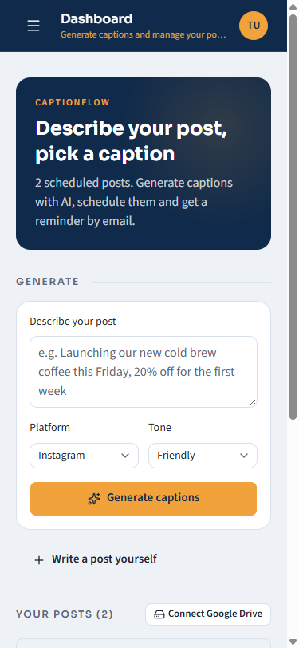
